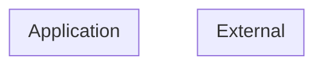

# Threat Model (auto-generated)

Generated by agentic-security on 2026-10-27.

This threat model is derived from static analysis of the current codebase and is regenerated on every scan. It is intended as a working artifact, not a finished compliance document.

## Entities + boundaries

## Assets

## STRIDE threats

### Tampering (1)

- [low] **supply-chain** (CWE-353) at `index.html:10` — Missing Subresource Integrity on cross-origin stylesheet

## Attack trees
